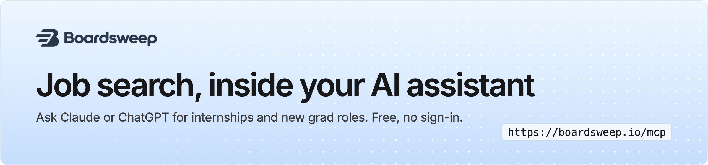

<div align="center">

<a href="https://boardsweep.io/assistants?utm_source=github&utm_medium=readme&utm_campaign=mcp"><picture><source media="(prefers-color-scheme: dark)" srcset="assets/banner-dark.png"></picture></a>

</div>

Add Boardsweep to **Claude**, **ChatGPT**, **Claude Code**, **Cursor** or **VS Code**, then ask in plain words: *"Find software internships in Seattle that list pay"* or *"Which quant firms have new grad roles open?"* Your assistant searches thousands of US tech internships and new grad roles read straight from company job boards, and every result links to the employer's own posting.

It's a free, read-only [MCP](https://modelcontextprotocol.io) server. There's nothing to install and no account or key needed.

```
https://boardsweep.io/mcp
```

<br>

## Add it to your assistant

### Claude (claude.ai and the desktop app)

1. Open **Settings**, then **Connectors**.
2. Choose **Add custom connector**.
3. Paste `https://boardsweep.io/mcp` and save.

### ChatGPT

1. In **Settings**, open **Apps and connectors**.
2. Turn on developer mode if it asks, then choose to add a connector.
3. Paste `https://boardsweep.io/mcp`. No sign-in is needed.

### Claude Code

```bash
claude mcp add --transport http boardsweep https://boardsweep.io/mcp
```

### Cursor

Add this to `~/.cursor/mcp.json` (or the project's `.cursor/mcp.json`):

```json
{
  "mcpServers": {
    "boardsweep": { "url": "https://boardsweep.io/mcp" }
  }
}
```

### VS Code

Add this to `.vscode/mcp.json`:

```json
{
  "servers": {
    "boardsweep": { "type": "http", "url": "https://boardsweep.io/mcp" }
  }
}
```

Any other client that supports remote MCP servers over streamable HTTP works the same way. Copies of these files are in [`examples/`](examples).

<br>

## What you can ask

| Ask | What happens |
| --- | --- |
| *"Show me AI/ML internships posted this week"* | Searches internships in the AI, ML and data field, newest first |
| *"New grad software roles in New York that list pay"* | Filters by level, field and city |
| *"Does Jane Street have anything open for new grads?"* | Finds the company, then its open roles |
| *"Robotics internships, remote or in the Bay Area"* | Matches words in the title, plus a location |
| *"Which cities can I filter by?"* | Lists every field and metro area it accepts |

<br>

## Tools

| Tool | What it does | Inputs |
| --- | --- | --- |
| `search_roles` | Open US tech internships and new grad roles, newest first, 25 a page. Each result links to the employer's own application page. | `level` (`internship` or `newgrad`), `track` (`software`, `aiml`, `quant`, `hardware`, `product`, `design`, `security`), `location` (a US metro or `remote`), `query` (words in the title or company), `company` (a slug from `find_company`), `page` |
| `find_company` | Companies with open roles that match a name, with their counts and their page on boardsweep.io | `name` |
| `list_filters` | Every value `search_roles` accepts for `track` and `location` | none |

Test it from the command line:

```bash
npx @modelcontextprotocol/inspector --cli https://boardsweep.io/mcp --transport http --method tools/list
```

<br>

## Good to know

- **Read-only, no sign-in.** The server can only search. It never sees your email, resume or chats, and it can't apply to anything.
- **About a day behind.** It returns the same roles as Boardsweep's free lists. Subscribers get them by email or push notification [the moment they're posted](https://boardsweep.io/?utm_source=github&utm_medium=readme&utm_campaign=mcp#pricing).
- **US and remote roles,** in software, AI/ML, quant, hardware, product, design and security.

<br>

<div align="center">

**Prefer a list?** [Summer 2027 internships](https://github.com/Boardsweep/summer-2027-internships) · [2027 new grad roles](https://github.com/Boardsweep/new-grad-2027) · [boardsweep.io](https://boardsweep.io/?utm_source=github&utm_medium=readme&utm_campaign=mcp)

<sub>Boardsweep isn't affiliated with Anthropic, OpenAI, Cursor or Microsoft. Claude, ChatGPT, Cursor and VS Code are trademarks of their owners.</sub>

</div>
